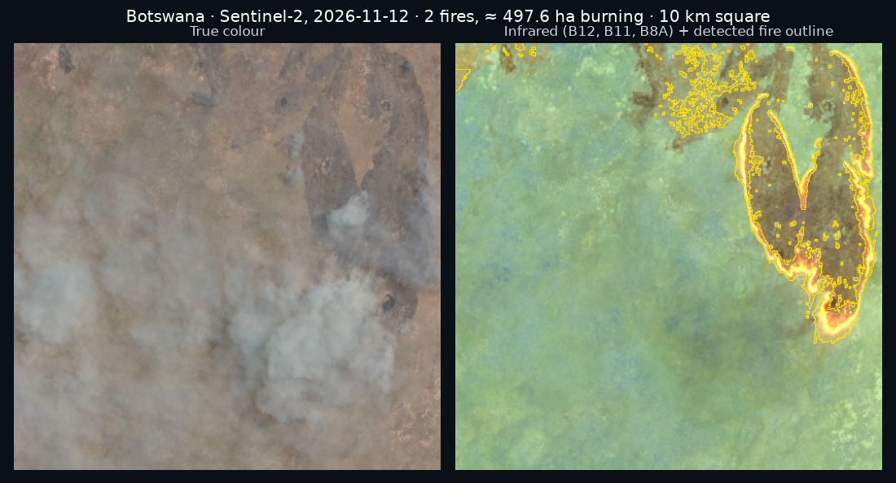
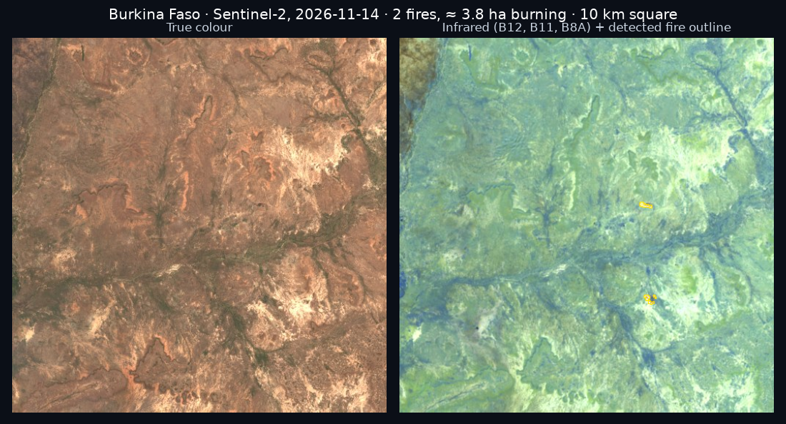
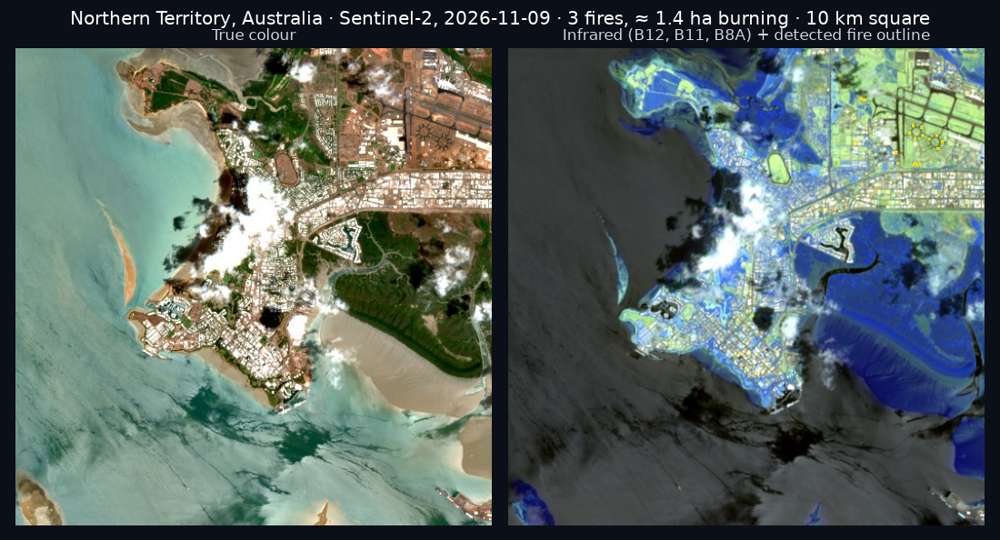

# Wildfire Detector

Finds **active fires, including small ones**, in Sentinel-2 satellite photos at 20 m resolution, anywhere on Earth.
Click a place on the map, and it downloads the latest clear photo of a 10 km square, compares it with how that
square looked in the 15 days before, and outlines every burning area with its size in hectares. NASA's
VIIRS/MODIS day-and-night heat detections from the last 48 hours are shown alongside.



| | |
|---|---|
|  |  |

## Results

Measured on **72,592 test tiles (640 m each) from 302 photos at places never used in training**: forest, savanna,
peat, volcanoes, oil and gas sites, 16 cities and cloudy scenes, on six continents.
The table below uses the automatic labels (hot pixels in the image + a same-day NASA detection within 2 km).
On blind hand labels the picture is different: see [Comparison with published methods](#comparison-with-published-methods).

| | photo only | **before + now (live)** |
|---|---|---|
| Alarms that are real fires (precision) | 82.4% | **84.2%** |
| Fire tiles caught (recall) | 86.3% | 86.0% |
| F1 | 0.843 | **0.851** |
| False alarms per 1,000 km² | 9.3 | **7.3** |
| False alarms per 1,000 km² in cities | **5.2** | 5.9 |
| False alarms per 1,000 km² at cloud edges | 3.3 | **1.7** |
| Fires caught: tiny (< 0.2 ha) / small (0.2–1 ha) / large (> 1 ha) | 59% / 88% / 95% | 56% / 88% / 96% |

For comparison, a no-learning rule ("any hot pixel") gets 47% precision and 160 false alarms per 1,000 km² on an
earlier, easier version of the same test.

## Comparison with published methods

Four published active-fire methods were re-implemented and run on the same 302 test photos:
Schroeder et al. 2016, Kumar & Roy 2018 and Murphy et al. 2016 (made for Landsat-8; adapted to Sentinel-2 bands
and 20 m pixels, see `src/rule_methods.py`), and Hu et al. 2021 (made for Sentinel-2, only for six biomes).
Each was run on top-of-atmosphere reflectance (Sentinel-2 L1C, the input they were designed for) and on the
surface reflectance our models use. A tile counts as flagged if any pixel in it is flagged.

**1. Automatic labels** (all 72,592 test tiles)

| | Alarms that are real fires | Fires caught | F1 | False alarms per 1,000 km² |
|---|---|---|---|---|
| **Ours: before + now** | 84.2% | **86.0%** | **0.851** | 7.3 |
| Schroeder 2016 | **92.4%** | 53.2% | 0.675 | **3.1** |
| Murphy 2016 | 88.0% | 60.3% | 0.716 | 7.4 |
| Kumar-Roy 2018 | 81.8% | 59.6% | 0.689 | 14.5 |
| Hu 2021 (its six biomes only) | 22.2% | 75.4% | 0.344 | 294.2 |

**2. Blind hand labels** (650 tiles labelled by eye, without knowing which method flagged them)

The tiles were drawn at random from fixed groups: flagged by every method, by some, by none but with a hot pixel,
and flagged only by the top-of-atmosphere versions. Tiles that no method flags and that have no hot pixel are
counted as no fire. Each group is weighted up to its full size, so the numbers stand for the whole test set.
Fire means flame or glow visible inside the tile at the time of the photo. 95% intervals by bootstrap.

| | Alarms that are real fires | Fires caught | F1 | False alarms per 1,000 km² |
|---|---|---|---|---|
| Ours: before + now | 57.5% (53–61) | **96.5% (94–99)** | 0.720 | 37.8 |
| Ours: photo only | 57.1% (53–61) | 96.9% (95–99) | 0.719 | 38.5 |
| **Schroeder 2016** | **92.4% (88–96)** | 86.0% (81–91) | **0.891** | **3.7** |
| **Murphy 2016** | 85.0% (80–90) | 93.5% (90–96) | **0.890** | 8.7 |
| Kumar-Roy 2018 | 77.0% (72–82) | 91.4% (88–95) | 0.836 | 14.5 |
| Hu 2021 (its six biomes only) | 17.1% (16–18) | 97.5% (95–99) | 0.291 | 262.2 |

Published methods on top-of-atmosphere input. On surface reflectance: Schroeder F1 0.891, Murphy 0.852,
Kumar-Roy 0.790. Full results: `outputs/methods_test.json` and `outputs/methods_handlabels.json`.

**What it means**

- On fire a person can see, **Schroeder 2016 and Murphy 2016 are better than our models.** Ours catch slightly more
  fires (96.5% vs 86–94%) but raise 4 to 10 times more false alarms.
- Most of our extra alarms are tiles with only 1–3 faint hot pixels, often next to burnt ground, where a person
  sees no fire. The automatic labels count such faint pixels as fire, and the models learned that definition.
  That is why the two scorings rank the methods in opposite order.
- The automatic labels favour our models; the hand labels are the fairer test. The fix is to train on labels that
  match what a person sees: a separate set of hand-labelled tiles (never these 650), then test again.
- Limits of this test: one labeller; Landsat methods adapted to Sentinel-2; Hu et al. only in its six biomes;
  fires that no method and no hot pixel finds are not counted.

## How it works

1. **Photo.** The newest Sentinel-2 L2A photo of the 10 km square from the last 15 days with ≤ 30% cloud
   (Earth Search STAC on AWS). Only that square is downloaded, as 7 bands at 20 m: B12, B11, B8A, B4, B3, B2 and B8.
2. **Before.** In parallel, up to 3 earlier photos of exactly the same pixels from the 15 days before. Per pixel,
   the median B12 and B11 over the clear ones (clouds and shadows removed with the scene classification map), plus
   a "seen clearly before" flag. This adds 3 bands.
3. **Models.** Each 32 px (640 m) tile is judged with a 64 px window around it by two models:
   - a U-Net trained from scratch;
   - a ResNet-18 pre-trained on Sentinel-2 (SSL4EO-S12, MoCo) and fine-tuned.

   Their weighted average is compared with a threshold. The weights and threshold are chosen on the validation set only.
4. **Checks.** Next to clouds, a tile only counts if it has a pixel that passes a strict flame test.
   Touching tiles are grouped into one fire. The fire's size counts only flame pixels (B12 ≥ 0.3, B12 ≥ 1.6 × B8A,
   B12 > B11), so burn scars don't inflate it.
5. **NASA.** VIIRS (NOAA-20, NOAA-21, Suomi NPP) and MODIS detections from the last 48 h, day and night. Sentinel-2
   only photographs in daylight; the thermal satellites see fires at night and through some smoke.

## What made the difference (the honest story)

- **The labels were the real problem, not the model.**
  - Marking a tile "fire" whenever NASA detected heat nearby was wrong 77% of the time: VIIRS passes about 3.4 hours
    after Sentinel-2, and fire fronts move 0.5–1.5 km in that time.
  - The new rule: the image says *where* (hot pixels: B12 high and brighter than B11 and B8A), and NASA says *whether*
    (a same-day detection within 2 km).
  - Then a manual check of 300 tiles where the model and the label disagreed: **253 were label errors**, including
    105 real fires NASA's 375 m sensor never labelled.
- **More data with the same labels barely helped.** Adding 547 archive photos moved the scores by about ±0.01 AP.
- **A brightness bug in the data source.** The −0.1 reflectance offset was applied twice, because the metadata still
  asked for it after the provider had already applied it. Every photo was too dark, and in Tokyo up to 85% of the
  visible-light pixels were clipped to zero. Fixing it, plus adding about 100 cities and cloudy scenes as hard
  examples, cut city false alarms from **195.5 to 5.2** per 1,000 km².
- **A rule that failed.** Dropping detections that were "already hot in an earlier photo" removed city false
  alarms, but recall fell from 86% to 57%: big fires burn for days. It was removed. The model was instead given the
  earlier photo as extra input and learned the difference itself (the before + now column above).
- **Complete data before training.** A first before + now run trained on half-downloaded history got 3× the false
  alarms. It was redone after all 1,623 photos had their history.

## Limits

- Sentinel-2 photographs each place about every 2–5 days, in daylight only, and can't see through cloud.
- Tiny fires (under 0.2 ha, 1–4 pixels) are caught only 56–59% of the time.
- On blind hand labels the models raise 37.8 false alarms per 1,000 km², mostly on faint 1–3 pixel heat that a
  person doesn't see as fire (see the comparison above). That is too many to alert on unconfirmed at world
  scale. A global alert system would need a second confirmation, such as a NASA detection or the next photo, and
  the models need retraining on labels that match what a person sees.
- The test set has only 7 cloud-edge photos, so the cloud-edge numbers are rough.

## Run it

```bash
pip install -r requirements.txt          # PyTorch with CUDA recommended; CPU works, slower
python app/server.py                     # then open http://127.0.0.1:8780
```

The trained models are in `outputs/`. NASA detections need a free FIRMS key
(https://firms.modaps.eosdis.nasa.gov/api/map_key/) saved as `firms_key.txt`. Everything else works without it.
If GDAL is slow behind a proxy, the code passes the system proxy to it.

### Rebuild the dataset and retrain

The dataset (about 17 GB) is not in the repository; the scripts rebuild it from public sources.

| Step | Script |
|---|---|
| Fire sites from NASA FIRMS (recent + archive) | `src/fetch_firms.py`, `src/fetch_firms_archive.py` |
| 10 km Sentinel-2 chips, fire-free chips, cities and cloud scenes | `src/fetch_s2.py`, `src/fetch_background.py`, `src/fetch_hard_negatives.py` |
| Brightness fix for already-saved chips | `src/fix_brightness.py` |
| Labels and tiles; the manual-check tool | `src/make_tiles.py`, `src/make_review_queue.py`, `src/review.py` |
| Model inputs (7 bands) and "before" bands | `src/prepare.py`, `src/fetch_history.py`, `src/prepare_history.py` |
| Training (`--history` for before + now) | `src/train_v2.py --model {tile,unet,pretrained}` |
| Scoring and model combination | `src/compare_models.py`, `src/eval_history.py` |

All splits are **by site**, so the same fire never appears in training and test.

## Data and credits

- Sentinel-2 L2A: contains modified Copernicus Sentinel data (ESA), via [Earth Search](https://earth-search.aws.element84.com/v1) (Element 84, AWS Open Data).
- Sentinel-2 L1C (top-of-atmosphere, for testing published methods): [Google Cloud public Sentinel-2 archive](https://cloud.google.com/storage/docs/public-datasets/sentinel-2).
- Active fires: [NASA FIRMS](https://firms.modaps.eosdis.nasa.gov/) (VIIRS 375 m, MODIS 1 km). We acknowledge the use of data and imagery from NASA's Fire Information for Resource Management System (FIRMS), part of NASA's Earth Science Data and Information System (ESDIS).
- Biomes: [RESOLVE Ecoregions 2017](https://ecoregions.appspot.com/).
- Pre-trained weights: SSL4EO-S12 ResNet-18 MoCo via [TorchGeo](https://github.com/microsoft/torchgeo).
- Reference implementation of the Schroeder, Murphy and Kumar-Roy rules: [pereira-gha/activefire](https://github.com/pereira-gha/activefire).
- Map: Leaflet with Esri World Imagery. Place search: OpenStreetMap Nominatim.
- Heat-source "type" field (0 = presumed vegetation fire, 1 = active volcano, 2 = other static land source, 3 = offshore). NASA says it exists only in the standard-quality (SP) archive, not in near-real-time data, so the heat map used the SP archive. Sources: [NASA MODAPS, VNP14IMGTDL_NRT attributes](https://modaps.modaps.eosdis.nasa.gov/services/about/products/viirs-land-c2-nrt/vnp14imgtdl_nrt.html) and [NASA Earthdata, FIRMS active fire data attributes](https://www.earthdata.nasa.gov/data/tools/firms/active-fire-data-attributes-modis-viirs).
- FIRMS area API (world-wide downloads in 5-day chunks, 5,000 transactions per 10 min): [firms.modaps.eosdis.nasa.gov/api/area](https://firms.modaps.eosdis.nasa.gov/api/area/).

## References

**Published fire-detection methods compared against**

1. Schroeder, W., Oliva, P., Giglio, L., Quayle, B., Lorenz, E., Morelli, F. (2016). Active fire detection using Landsat-8/OLI data. *Remote Sensing of Environment* 185, 210–220. https://doi.org/10.1016/j.rse.2015.08.032
2. Murphy, S. W., de Souza Filho, C. R., Wright, R., Sabatino, G., Correa Pabon, R. (2016). HOTMAP: Global hot target detection at moderate spatial resolution. *Remote Sensing of Environment* 177, 78–88. https://doi.org/10.1016/j.rse.2016.02.027
3. Kumar, S. S., Roy, D. P. (2018). Global operational land imager Landsat-8 reflectance-based active fire detection algorithm. *International Journal of Digital Earth* 11(2), 154–178. https://doi.org/10.1080/17538947.2017.1391341
4. Hu, X., Ban, Y., Nascetti, A. (2021). Sentinel-2 MSI data for active fire detection in major fire-prone biomes: A multi-criteria approach. *International Journal of Applied Earth Observation and Geoinformation* 101, 102347. https://doi.org/10.1016/j.jag.2021.102347
5. de Almeida Pereira, G. H., Fusioka, A. M., Nassu, B. T., Minetto, R. (2021). Active fire detection in Landsat-8 imagery: A large-scale dataset and a deep-learning study. *ISPRS Journal of Photogrammetry and Remote Sensing* 178, 171–186. https://doi.org/10.1016/j.isprsjprs.2021.06.002

**Related work that shaped the design**

6. Urbanelli, A., Barco, L., Arnaudo, E., Rossi, C. (2023). A Multimodal Supervised Machine Learning Approach for Satellite-based Wildfire Identification in Europe. arXiv:2308.02508. https://arxiv.org/abs/2308.02508 (hot-spot history as context: the idea behind the before + now model)
7. Barco, L., Urbanelli, A., Rossi, C. (2024). Rapid Wildfire Hotspot Detection Using Self-Supervised Learning on Temporal Remote Sensing Data. arXiv:2405.20093. https://arxiv.org/abs/2405.20093 (a fast, coarse geostationary tier; a possible complement)

**Data and models**

8. Schroeder, W., Oliva, P., Giglio, L., Csiszar, I. A. (2014). The New VIIRS 375 m active fire detection data product: Algorithm description and initial assessment. *Remote Sensing of Environment* 143, 85–96. https://doi.org/10.1016/j.rse.2013.12.008
9. Giglio, L., Schroeder, W., Justice, C. O. (2016). The collection 6 MODIS active fire detection algorithm and fire products. *Remote Sensing of Environment* 178, 31–41. https://doi.org/10.1016/j.rse.2016.02.054
10. Wang, Y., Braham, N. A. A., Xiong, Z., Liu, C., Albrecht, C. M., Zhu, X. X. (2023). SSL4EO-S12: A large-scale multimodal, multitemporal dataset for self-supervised learning in Earth observation. *IEEE Geoscience and Remote Sensing Magazine* 11(3), 98–106. https://doi.org/10.1109/MGRS.2023.3281651
11. Stewart, A. J., Robinson, C., Corley, I. A., Ortiz, A., Lavista Ferres, J. M., Banerjee, A. (2022). TorchGeo: Deep learning with geospatial data. *Proceedings of the 30th International Conference on Advances in Geographic Information Systems (SIGSPATIAL '22)*, 1–12. https://doi.org/10.1145/3557915.3560953
12. Dinerstein, E., Olson, D., Joshi, A., Vynne, C., Burgess, N. D., Wikramanayake, E., et al. (2017). An Ecoregion-Based Approach to Protecting Half the Terrestrial Realm. *BioScience* 67(6), 534–545. https://doi.org/10.1093/biosci/bix014

**Methods used in training**

13. Ronneberger, O., Fischer, P., Brox, T. (2015). U-Net: Convolutional Networks for Biomedical Image Segmentation. *MICCAI 2015*, LNCS 9351, 234–241. https://doi.org/10.1007/978-3-319-24574-4_28 (the pixel model)
14. He, K., Zhang, X., Ren, S., Sun, J. (2016). Deep Residual Learning for Image Recognition. *CVPR 2016*, 770–778. https://doi.org/10.1109/CVPR.2016.90 (ResNet-18, the body of the pretrained model)
15. He, K., Fan, H., Wu, Y., Xie, S., Girshick, R. (2020). Momentum Contrast for Unsupervised Visual Representation Learning. *CVPR 2020*, 9729–9738. https://doi.org/10.1109/CVPR42600.2020.00975 (MoCo, how the SSL4EO-S12 starting weights were learned)
16. Hinton, G., Vinyals, O., Dean, J. (2015). Distilling the Knowledge in a Neural Network. arXiv:1503.02531. https://arxiv.org/abs/1503.02531 (teacher-student training: the photo-only students, `train_v2.py --teacher`)
17. Polyak, B. T., Juditsky, A. B. (1992). Acceleration of Stochastic Approximation by Averaging. *SIAM Journal on Control and Optimization* 30(4), 838–855. https://doi.org/10.1137/0330046 (weight averaging)
18. Tarvainen, A., Valpola, H. (2017). Mean teachers are better role models: Weight-averaged consistency targets improve semi-supervised deep learning results. *NeurIPS 2017*. arXiv:1703.01780. https://arxiv.org/abs/1703.01780 (exponential moving average of weights, `--ema 0.999`)
19. Loshchilov, I., Hutter, F. (2019). Decoupled Weight Decay Regularization. *ICLR 2019*. arXiv:1711.05101. https://arxiv.org/abs/1711.05101 (AdamW optimizer)
20. Loshchilov, I., Hutter, F. (2017). SGDR: Stochastic Gradient Descent with Warm Restarts. *ICLR 2017*. arXiv:1608.03983. https://arxiv.org/abs/1608.03983 (cosine learning-rate schedule)

## License

MIT (code). The data and pre-trained weights keep their own licenses.
